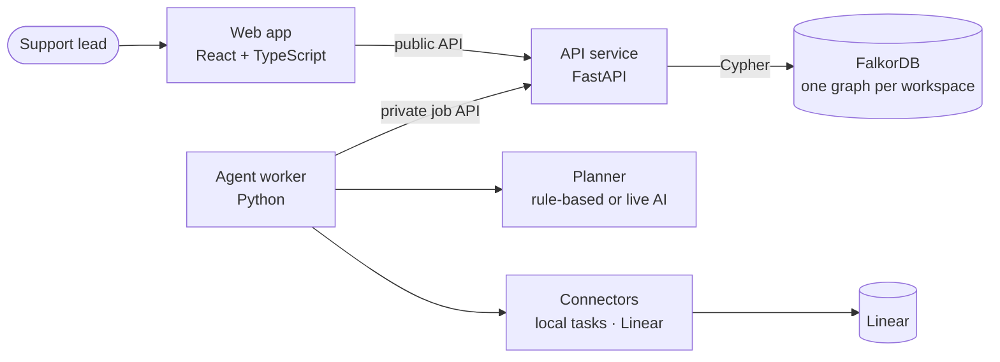

# PromiseGraph

**A customer-operations agent with a graph memory, built on FalkorDB.**

▶ **Demo video:** https://youtu.be/aNkvh3nrXFc

A customer writes: *"Our scheduled exports stopped working. We need them before Friday."* To answer well, a support
lead has to work out whether it's a known bug, who owns the fix, what that fix is blocked on, whether a workaround
already failed for this customer, and whether a company rule applies. PromiseGraph does that investigation in a
FalkorDB knowledge graph and recommends the best next step:

| Next step | What happens |
| --- | --- |
| **Reply with an answer** | Drafts a sourced reply from the documentation and past verified resolutions |
| **Ask the customer a question** | Asks one targeted question when the request is ambiguous, then resumes when they reply |
| **Attach to existing work** | Links the request to the engineering work that already covers it, with no duplicate ticket and no invented date |
| **Create a new task** | Creates a task with acceptance criteria, locally or as a real **Linear** issue |
| **Hand off to a person** | Escalates when company rules conflict or the critical-path owner is gone |

Every recommendation shows the graph path and the exact sources behind it, and a person approves it before anything
happens. PromiseGraph remembers outcomes: a workaround that failed for one customer is not suggested to them again, and
a request only counts as solved once someone confirms it.

**Hackathon:** Graph Hacks 2026 · **Tracks:** Company Brain · Agents That Act on Connected Data · Agent Memory and Coordination
· **Data:** fully synthetic, with fictional companies.

## How FalkorDB powers it

FalkorDB is the only database. It holds the company knowledge, the agent's memory and the agent's durable state.

- **Multi-hop reasoning.** The agent walks bounded paths such as
  `Request → Capability → WorkItem → DEPENDS_ON → WorkItem → OWNED_BY → Person` to find what a request is really blocked on.
- **Scoped memory.** Company rules (*Decisions*) and past *Attempts* are linked to the customer, product area or work
  they apply to, so memory changes behaviour only where it should.
- **Durable agent state.** Runs, an ordered event log, a lease-fenced job queue, proposals, actions and receipts live
  in the graph, so the agent survives restarts.
- **All-or-nothing writes.** Each change is a single guarded Cypher query, giving optimistic concurrency, worker
  fencing and safe retries.

**Graph data model and the Cypher queries the product depends on: [docs/GRAPH.md](docs/GRAPH.md)**

## Architecture



- **The API is the only service that talks to FalkorDB.** It validates every suggestion: cited evidence must exist and
  be current, company rules are enforced, and suggestions based on outdated facts are blocked.
- **The agent worker** claims jobs with a lease, investigates with 8 typed tools (`search_context`, `expand_context`,
  `read_evidence`, `read_memory`, `prepare_action`, `commit_action`, `inspect_action`, `record_observation`) and
  carries out approved actions. It has no database credentials.
- **The planner** is rule-based by default. A live AI model (OpenAI) can be switched on and uses exactly the same tools
  and checks.
- **API contracts** are JSON schemas in [`contracts/`](contracts/), with generated Python and TypeScript types.

| Folder | What's inside |
| --- | --- |
| `services/api` | FastAPI service: graph store, import, context retrieval, actions, job queue |
| `services/worker` | Agent loop, planners, connectors (local, Linear), AI spend cap |
| `apps/web` | Web app: request inbox and investigation workspace |
| `contracts` | API schemas and generated types |
| `fixtures` | Synthetic company dataset and test scenarios |
| `tests/browser` | Playwright end-to-end tests |
| `scripts` | Seeding, local demo and test runners |

## Run it locally

Prerequisites: Docker, Python 3.12 with [uv](https://docs.astral.sh/uv/), and Node 22 with pnpm.

```bash
cp .env.example .env      # local settings; AI and Linear are off by default
scripts/demo.sh up        # starts FalkorDB, the API (:8000), the worker and the web app (:5173), and loads the demo data
open http://localhost:5173
```

`scripts/demo.sh down` stops everything and keeps the data. `scripts/demo.sh reset` reloads the demo data from scratch.

Try it: click **New request → Try an example**, submit, and open the request to see what PromiseGraph found and what it
recommends.

### Optional: Linear and live AI

In `.env`:

- **Linear:** `LINEAR_ENABLED=true`, `LINEAR_API_KEY`, `LINEAR_TEAM_ID`. New tasks are created as Linear issues after approval.
- **Live AI:** `AI_ENABLED=true`, `AI_PROVIDER=openai`, `AI_MODEL`, `AI_API_KEY`, and a hard budget `AI_BUDGET_USD` with
  `AI_PRICE_INPUT_PER_MTOK` / `AI_PRICE_OUTPUT_PER_MTOK`. The worker reserves the worst-case cost before every call and
  never exceeds the budget.

## Tests

```bash
(cd services/api && uv run pytest -q)                                 # API against real FalkorDB
(cd services/worker && uv run pytest -q --ignore=tests/integration)   # agent worker
scripts/check_persistence.sh                                          # state survives a database restart
uv run --no-project --with httpx==0.28.1 --with jsonschema==4.25.1 \
  python scripts/run_scenarios.py --manage --port 8050                # end-to-end scenarios on a fresh stack
(cd tests/browser && PG_TARGET=real npx playwright test)              # browser journeys, keyboard and mobile
```

## Built with AI assistance

Built during the hackathon with the help of Claude Code (Anthropic).
